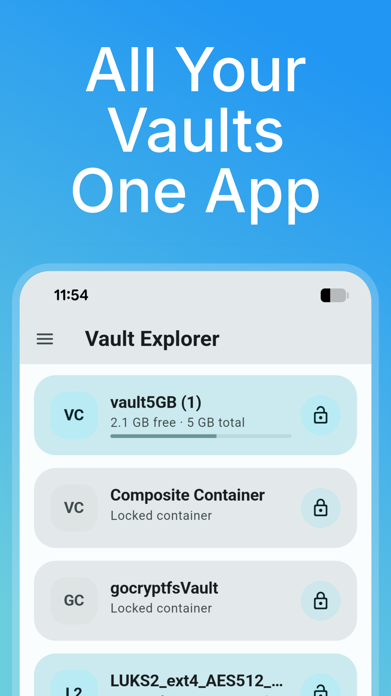
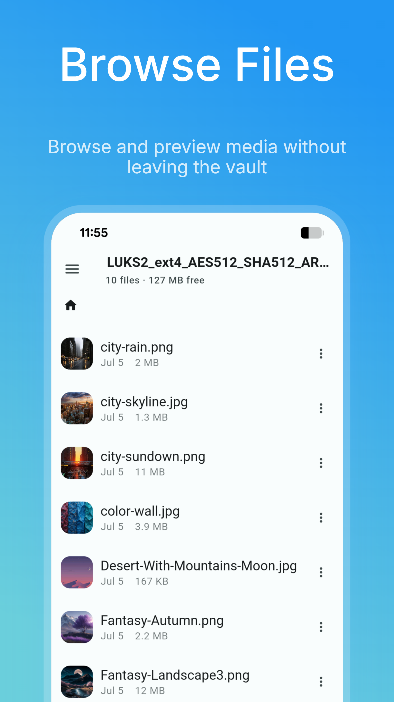
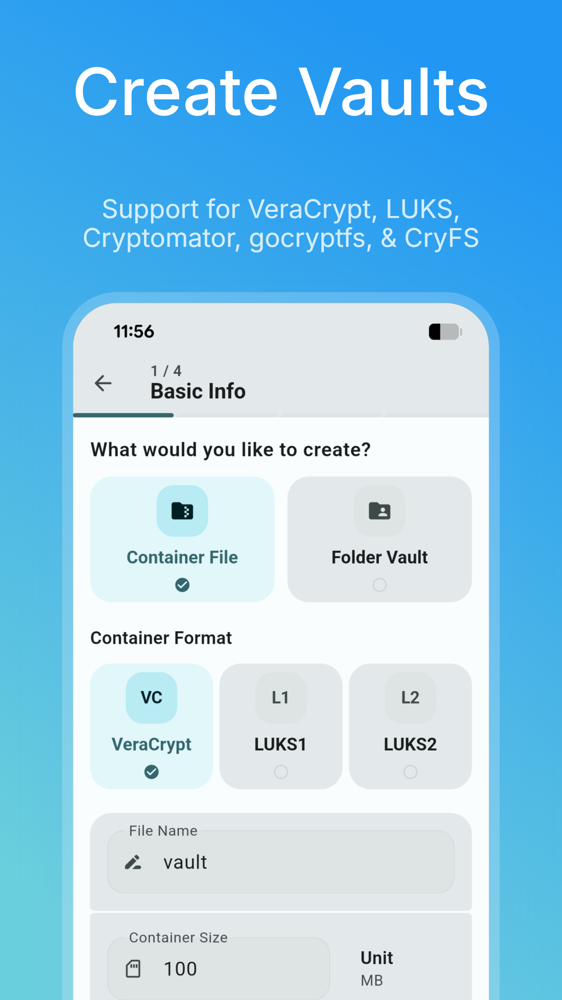
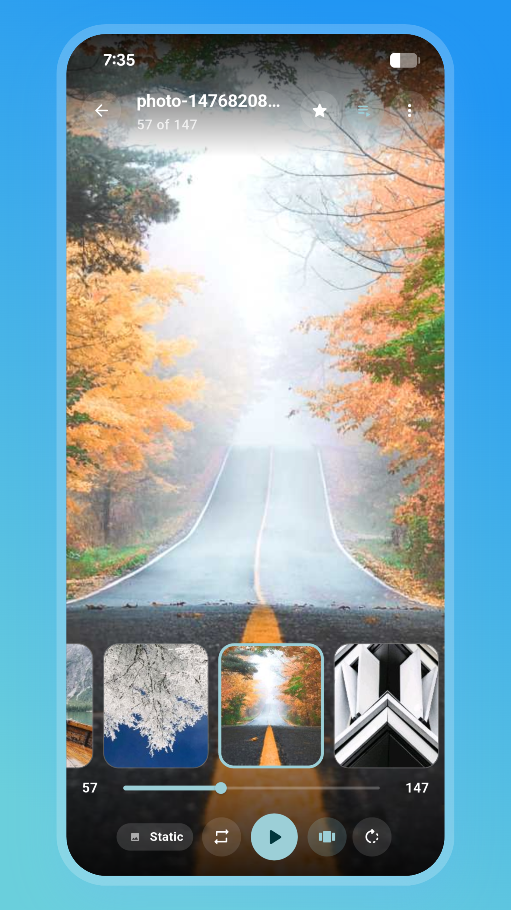
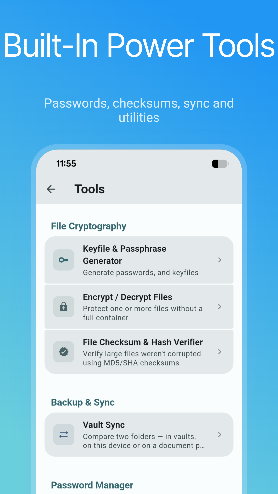

# VaultExplorer

[](https://developer.android.com)
[](https://www.gnu.org/licenses/gpl-3.0)
[](https://ko-fi.com/K3K2ND3Y8)

Mount, browse, and manage encrypted containers on Android without a PC.

VaultExplorer opens VeraCrypt, LUKS, BitLocker, VHD/VHDX, Cryptomator, gocryptfs, and CryFS volumes. A native C++ engine decrypts in memory where possible, and the app has no internet permission. Operations that need a scratch file (video recording, exports, archive work) use the app's private cache and zero-wipe it afterwards.

## Screenshots

<p align="center">
  
  
  
  
  
</p>

## Supported formats

| Format | Details |
|---|---|
| **VeraCrypt** | Standard and hidden volumes, PIM, keyfiles, all ciphers and cascades (AES, Serpent, Twofish, Camellia, Kuznyechik), password change |
| **LUKS1 / LUKS2** | `xts-plain64`, PBKDF2 or Argon2id/i, passphrase or keyfile |
| **BitLocker** | Password or 48-digit recovery key, including BitLocker To Go |
| **VHD / VHDX** | Fixed and dynamic images containing a VeraCrypt, LUKS, or BitLocker volume, or an unencrypted filesystem |
| **Cryptomator** | Vault formats 7 and 8 |
| **gocryptfs** | Format v2, AES-256-GCM or XChaCha20-Poly1305 |
| **CryFS** | Format 0.10 (CryFS 0.10.x–1.0.x), AES or XChaCha20-Poly1305 |

Filesystems: FAT12/16/32, exFAT, NTFS, ext2/3/4.

## Features

- **File explorer** — list, grid, and masonry views, search, breadcrumbs, folder sizes, bookmarks, per-folder layout and sort, a customizable toolbar, and file manager skins. Thumbnails can size themselves to the grid cell (Auto) or use a manual size, and grid and masonry views can use rounded or square corners with adjustable spacing. Batch rename supports search and replace (optionally regex), date/time, UUID, and counter tokens, case changes, and a live preview. Copy, move, import, export, and extraction never overwrite names that differ only by letter case on case-insensitive filesystems; collisions are renamed `name (1)`
- **Built-in viewers** — photos, video/audio (subtitles, speed control, A-B repeat, equalizer, volume boost, selectable video/audio decoders, contrast and saturation adjustments with presets, media notification controls), PDF, HTML, Markdown, Word/PowerPoint/Excel and OpenDocument documents (`.docx`, `.pptx`, `.xlsx`, `.ppt`, `.odt`, `.odp`, `.ods` and their macro/template variants; a read-only reading view, not an editor, and not for password-protected files or legacy `.doc`/`.xls`), and a text/code editor (tabs, find and replace, large-file handling), streamed from the encrypted volume. PDF search needs Android 12+ with the system PDF extension. APK files can be sent to the system installer or opened as ZIP
- **Image editor** — crop, rotate, draw, text, and redaction boxes, with no plaintext temp file
- **Video editor** — lossless cuts on keyframes: keep or cut out segments, merge the clips or save them separately, or replace the original. Nothing is re-encoded, and embedded subtitle tracks are not preserved
- **Audio editor** — the same lossless cut, split, and merge on a waveform timeline, with an optional lower-bitrate AAC export to shrink files. Tags and cover art are not carried over
- **Archive browser** — open ZIP, 7-Zip, RAR4/RAR5, TAR, gzip, bzip2, xz, and zstd archives in place (including password-protected ZIP, 7-Zip, and RAR5), extract entries, and create ZIP, 7-Zip (optional AES-256, with optional encrypted file names), TAR, ISO9660, or CPIO archives. Works inside vaults and on regular device storage
- **Vault camera** — save photos and video directly into a container, with optional background recording. Optional Quick Settings tile and home screen shortcut, enabled in Settings
- **Document scanner** — a scan mode in the vault camera. Page edges are detected live, you can drag the four corners to fit, choose Original, Color, Grayscale, or B&W, rotate, and add more pages. Save as one multi-page PDF or as separate images, straight into the container. Edge detection, perspective correction, and filters run in a bundled C++ module with no OpenCV, and the PDF is built in memory with no author, date, or device metadata
- **Audio recorder** — record directly into a container, with pause and resume and a Voice, Standard, or High quality profile (AAC, mono)
- **Item vault** — passwords, cards, bank accounts, notes, identities, licenses, and TOTP codes. Import and export KeePass (.kdbx), Bitwarden (.json), Proton (.json), CSV (Bitwarden, LastPass, Chrome, 1Password, Dashlane, NordPass, Apple Passwords), and `otpauth://` lists. Import authenticator codes from Ente Auth, Aegis, 2FAS, andOTP, Raivo, LastPass Authenticator, and Google Authenticator. See [`docs/password-interchange.md`](docs/password-interchange.md)
- **Authenticator** — a dedicated page with live TOTP and HOTP codes from every unlocked vault, plus the next code. Add codes by scanning a QR code (including multi-part Google Authenticator transfer codes) or by importing a backup from Aegis, 2FAS, Bitwarden, Ente, Proton, or andOTP
- **Cloud and external storage** — open containers from Google Drive, other Android document providers (e.g. pCloud), or bridge apps such as [RSAF](https://github.com/chenxiaolong/RSAF) or [Round-Sync](https://github.com/newhinton/Round-Sync) for WebDAV, S3, Dropbox, and more. The app itself never uses the network. Local storage and SD cards can be added as locations
- **Open in other apps** — expose an unlocked container or subfolder to other apps, or share files through the Android Share menu. An optional background service keeps a vault mounted
- **Share sheet integration** — receive files from other apps into a vault folder you pick. Off by default
- **Automation (beta)** — a local broadcast-intent API for Tasker or MacroDroid: unlock/lock, sync, import/export, secure wipe, camera capture, audio recording, emergency lock and purge. Off by default. Each vault opts in to a permission tier and requires an API token; camera capture needs a separate opt-in. See [`docs/vaultexplorer-automation-setup.md`](docs/vaultexplorer-automation-setup.md)
- **Auto-sync** — one-way backup, one-way import, or two-way sync between a vault or folder and another folder, on unlock and optionally while open. Rules are stored encrypted in the vault. Conflicts keep both versions. Deletion sync pauses if a folder looks unexpectedly empty or too many files would be deleted. A rule can also run once a day in the background while the vault is locked (needs full automation access and a saved vault password), and folder-to-vault imports can delete the source file only after the vault copy's size and SHA-256 checksum match
- **Emergency panic and duress** — three purge tiers that never touch container files: (1) lock vaults and forget remembered passwords, (2) also wipe credentials, master lock, and settings, (3) also shred the app's storage and request uninstall. Triggered from a Quick Settings tile, a PanicKit app (e.g. Ripple, Wasted), an automation broadcast, an armed reboot trigger, or a duress PIN, pattern, or password
- **Composite containers** — spread a VeraCrypt-format volume across several photo, video, audio, or document files. Data is appended to each file as extra "growth" (3–30%, default 10%), and all files are required to unlock
- **USB OTG** — read and write USB drives without root
- **Create and format** new volumes on device storage or a USB drive, with an optional randomness pad that mixes your touch movements into the keys and salts alongside the device's secure random generator
- **Up to 8 volumes** mounted at once
- **Themes and settings** — 11 languages (Arabic, Chinese, English, French, German, Italian, Japanese, Korean, Portuguese, Spanish, Ukrainian), Default and OLED skins, a custom skin editor with per-page colors, Material You colors, a built-in Logcat viewer, and settings export/import (app, file manager, media player and text editor settings, with custom skins optional; never passwords, keys, or the container list)

### Tools tab

- **Keyfile & Passphrase Generator** — Diceware passphrases, passwords, keyfiles
- **Encrypt / Decrypt Files** — individual files, no container needed
- **Hash Verifier** — check files against MD5/SHA checksums
- **Vault Sync** — compare two folders and copy missing or newer files
- **Import / Export Passwords** — see Item vault above
- **Storage Analyzer** and **Duplicate Finder**
- **Split & Join** — split a container into chunks or rejoin them
- **Composite Container** — create or mount a composite container
- **Check & Repair** — diagnose header or filesystem issues
- **Header Backup** — back up and restore a container's header (or a folder vault's config file)

## Security & privacy

- No `INTERNET` permission
- Decryption and re-encryption happen in memory. Scratch files stay in the app's private cache, are zero-wiped and deleted when done, and leftovers from a crash are wiped at next launch
- Master lock via password, PIN, pattern, or biometrics. After the 5th failed attempt the lockout starts at 30 seconds and grows by 30 seconds per further failure, up to 5 minutes, and survives force-kills. Individual containers can be unlocked by password, remembered password, biometrics, pattern, or PIN. Removing the master password requires the master password itself. Saved credentials are never shown in plain text, and PIM values are obfuscated during unlock
- Optional key caching in the Android Keystore (AES-GCM, hardware-backed where supported)
- Task-switcher previews are blocked and the screen is blanked when the app is backgrounded. Screenshot blocking (`FLAG_SECURE`) is on by default and can be turned off in Settings
- Passwords copied from the Item Vault are marked sensitive on Android 13+ and cleared after 30 seconds if unchanged. Corrupted clipboard data from other apps is sanitized on window focus
- Android backup is disabled
- **Mask Mode** — disguises the app as a local file manager for device storage (browse, open, and edit files and archives, with no vault or encryption code involved). Hold the title for 2 seconds to reach the vault

See [PRIVACY_POLICY.md](PRIVACY_POLICY.md) for what the app accesses and what leaves your device.

## Install

Download the APK for your architecture (arm64, armeabi, or x64) from [Releases](https://github.com/R0b0To/VaultExplorer/releases). Requires Android 8.0 (API 26) or newer.
The published APKs are signed using a certificate with the following SHA-256 fingerprint `0bde9d3b0ee3f56617d02632c843b1629bf0b2faa4560dff5d26f651dc325f19`

### Build from source

```bash
git clone --recurse-submodules https://github.com/R0b0To/VaultExplorer.git
cd VaultExplorer
.flutter/bin/flutter pub get
.flutter/bin/flutter build apk --release
```

Flutter is vendored as a pinned git submodule (`.flutter/`). If you cloned without `--recurse-submodules`, run `git submodule update --init`. Requirements: Android SDK 26+, Java 21, and CMake 3.18+. Gradle installs the NDK (r28c), and CMake builds the native C++ dependencies. Versions and licenses: [NOTICE.md](NOTICE.md).

## Donate

Support the project:

[](https://ko-fi.com/K3K2ND3Y8)

- **Bitcoin (BTC):** `bc1qszzfa2sm7hzyvd7wktgtfzgpmyv7e7um0wrtl2`
- **Lightning:** `aeidolon@cake.cash`
- **Monero (XMR):** `88qPr4aY9B62c1LXoiX9YV58gKB2jFYRx9YijBgPK3h32HnF93aytJCPKu58fbpa8XNKbJWpFGnnGM81rBCdpUje1WvfHaY`

## License

GPLv3. See [LICENSE](LICENSE).
