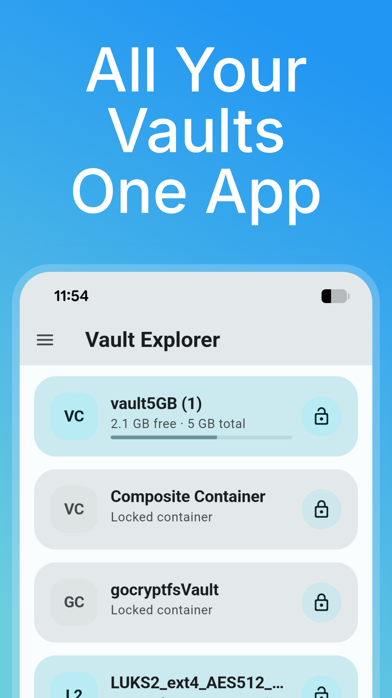
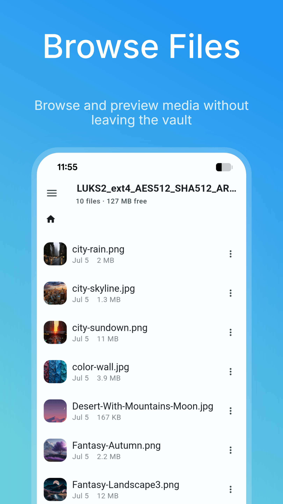
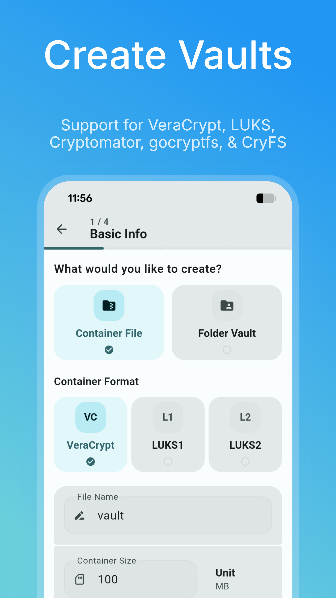
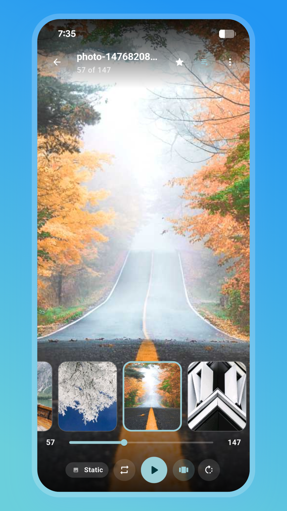
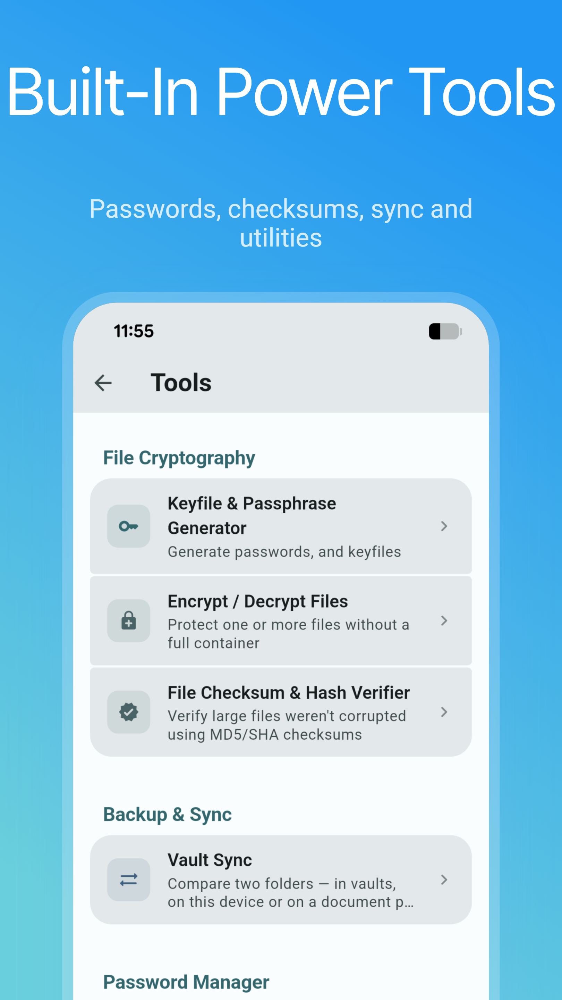

# VaultExplorer

[](https://developer.android.com)
[](https://www.gnu.org/licenses/gpl-3.0)
[](https://ko-fi.com/K3K2ND3Y8)

Mount, browse, and manage encrypted containers on Android without a PC.

VaultExplorer opens VeraCrypt, LUKS, BitLocker, VHD/VHDX, Cryptomator, gocryptfs, and CryFS volumes. A native C++ engine decrypts in memory where possible, and the app has no internet permission. Operations that need a scratch file (video recording, exports, archive work) use the app's private cache and zero-wipe it afterwards.

## Screenshots

<p align="center">
  
  
  
  
  
</p>

## Supported formats

| Format | Details |
|---|---|
| **VeraCrypt** | Standard and hidden volumes, PIM, keyfiles, all ciphers and cascades (AES, Serpent, Twofish, Camellia, Kuznyechik), password change, backup-header recovery, desktop-compatible `.vchdr` backup import/export, and in-place volume expansion |
| **LUKS1 / LUKS2** | `xts-plain64` / `xts-plain` (AES-128 and AES-256, Serpent, Twofish, Camellia, Kuznyechik) and `cbc-plain` / `cbc-plain64` / `cbc-essiv:sha256` (AES, plus the other ciphers at 256 bit); PBKDF2 (SHA-1/224/256/384/512, SHA-3, RIPEMD-160, Whirlpool) or Argon2id/i; 512-4096 byte sectors; any LUKS2 metadata size, multiple keyslots, keyslot priorities; passphrase or keyfile; password change; in-place volume expansion. Not supported: dm-integrity / AEAD volumes, in-progress reencryption, `ecb` / `lrw` / `benbi` / `tcw` modes, AES-192, Argon2 memory above 1 GiB. Interoperability with upstream cryptsetup is checked by the differential suite in [`crypto/test/luks_compat`](android/app/src/main/cpp/crypto/test/luks_compat/README.md) |
| **BitLocker** | Password or 48-digit recovery key, including BitLocker To Go, and volume / VHD / VHDX expansion |
| **VHD / VHDX** | Fixed and dynamic images containing a VeraCrypt, LUKS, or BitLocker volume, or an unencrypted filesystem; in-place expansion |
| **Cryptomator** | Vault formats 7 and 8, format 7-to-8 migration, and in-vault symbolic links |
| **gocryptfs** | Format v2 as written by gocryptfs 0.7 up to current: AES-256-GCM, XChaCha20-Poly1305 or AES-SIV; encrypted, plaintext or `-deterministic-names` file names; `-longnamemax`; vaults from before HKDF/Raw64. Not supported: FIDO2-protected vaults; symlinks are not shown ([details](android/app/src/main/cpp/foldervault/README.md#gocryptfs-conformance-with-the-official-implementation)) |
| **CryFS** | Format 0.10 (CryFS 0.10.x–1.0.x and 2.x), all 21 ciphers of the C++ release (AES, XChaCha20-Poly1305, Twofish, Serpent, CAST-256, MARS; GCM and CFB). Official scrypt settings up to 1 GiB are supported on a bounded amount of RAM. Vaults still in an older format, or locked to another device ("single-client mode"), are not modified without your consent. |

Filesystems: FAT12/16/32, exFAT, NTFS, ext2/3/4. Symbolic links are supported inside Cryptomator vaults and ext2/3/4 or NTFS filesystems in VeraCrypt/LUKS containers (links stay inside the container; editors save to the target).

## Features

- **File explorer** — list, grid, and masonry (justified-row mosaic) views, search, breadcrumbs, folder sizes, bookmarks, per-folder layout and sort, full-screen drag drawer, a customizable toolbar with independent auto-hide for the toolbar and breadcrumb bars, and file manager skins. Directory listing caching (stale-while-revalidate) and progressive loading keep browsing responsive in large folders. A fast scrollbar includes date and section markers. Thumbnails can size themselves to the grid cell (Auto) or use a manual size, and grid and masonry views can use rounded or square corners with adjustable spacing. High-performance native C++ volume manager handles cross-volume and SAF file transfers with progress, cancellation, and clean rollback. Batch rename supports search and replace (optionally regex), date/time, UUID, and counter tokens, case changes, and a live preview. Copy, move, import, export, and extraction never overwrite names that differ only by letter case on case-insensitive filesystems; collisions are renamed `name (1)`. Option to show or hide media in folders containing `.nomedia` files, and confirmed reset for file manager preferences
- **Gallery mode** — browse photos and videos with faceted filtering by media type, capture date, tags, place, camera model, orientation, rating, file size, folder, or missing metadata (with "Match any" and "Match all" tag logic). Group items by day, month, year, folder, media type, place, or camera. An offline city database (GeoNames, ~25 km radius) resolves photo locations without internet access. Limit scans to chosen folders and subfolders per storage. Scroll anchoring preserves your viewport position when filters or folder contents change. Metadata indexes are cached encrypted in the vault (`/.vaultexplorer/gallery_meta.json`) or in private storage, updated incrementally using append-logs. See [`docs/gallery-filter.md`](docs/gallery-filter.md)
- **Music library** — optional dedicated music mode per location or tab with Tracks, Albums, Artists, Genres, and Folders (direct audio folders only) views, search, and sorting. Merges music across multiple unlocked containers and device storage into one unified library (`MusicHub`). Reads audio metadata and embedded artwork from MP3, FLAC, Ogg, Opus, MP4/M4A, and WAV files. Includes an animated mini player bar that smoothly gestures up into a full-screen music player with cover art animation, waveform timeline seeking, playback queue, repeat (off / all / one), and shuffle (preserving current playing track). Choose whole-storage or folder-scoped scanning. See [`docs/music-library.md`](docs/music-library.md)
- **Built-in viewers** — photos, video/audio (subtitles, speed control, A-B repeat, equalizer, volume boost, selectable video/audio decoders, contrast and saturation adjustments with presets, media notification controls), Motion Photos (embedded video playback with saved autoplay preference), 360° panoramas (equirectangular and untagged 2:1 panoramic images with interactive touch pan and optional gyroscope sensor navigation via custom GLSL shader), HEIF/HEIC images (detailed Exif/XMP metadata, portrait fit handling, and capture-date editing), PDF, HTML, Markdown, EPUB e-books (contents list, text size and reading themes; JavaScript stays off), comics (`.cbz`, plus `.cbr`/`.cb7`/`.cbt` when they are really ZIPs; a true RAR or password-protected comic opens in the archive browser instead; pages are zoomable and can be read right to left), and a text editor, streamed from the encrypted volume. PDF search needs Android 12+ with the system PDF extension. APK files can be sent to the system installer or opened as ZIP. Viewers automatically close cleanly if their source container is locked or its USB storage is unplugged
- **Android 360° video** — tap the 360° button in the video viewer to look around a 2D equirectangular video by dragging. Turn on Gyro to look around by moving the device. The usual playback controls remain available.
- **Image metadata editor** — view and edit Exif, XMP, and IPTC metadata for single images or batch selections: modify tags/keywords, set or shift capture dates (or copy from file modification time or filename), and strip metadata (Exif, XMP, IPTC/Photoshop, comments, color profiles; optional orientation retention). Supported on JPEG, PNG, WebP, and HEIF/HEIC (with embedded capture-date editing). Read-only containers are never modified
- **Image editor** — crop, rotate, draw, text, and redaction boxes, with no plaintext temp file
- **Video editor** — lossless cuts on keyframes: keep or cut out segments, merge the clips or save them separately, or replace the original. Nothing is re-encoded, and embedded subtitle tracks are not preserved
- **Audio editor** — the same lossless cut, split, and merge on a waveform timeline, with an optional lower-bitrate AAC export to shrink files. Tags and cover art are not carried over
- **Archive browser** — open ZIP, 7-Zip, RAR4/RAR5, TAR, gzip, bzip2, xz, and zstd archives in place (including password-protected ZIP, 7-Zip, and RAR5), extract entries, and create ZIP, 7-Zip (optional AES-256, with optional encrypted file names), TAR, ISO9660, or CPIO archives. Works inside vaults and on regular device storage
- **Vault camera** — save photos and video directly into a container, with optional background recording. Optional Quick Settings tile and home screen shortcut, enabled in Settings
- **Document scanner** — a scan mode in the vault camera. Page edges are detected live, you can drag the four corners to fit, choose Original, Color, Grayscale, or B&W, rotate, and add more pages. Save as one multi-page PDF or as separate images, straight into the container. Edge detection, perspective correction, and filters run in a bundled C++ module with no OpenCV, and the PDF is built in memory with no author, date, or device metadata
- **Audio recorder** — record directly into a container, with pause and resume and a Voice, Standard, or High quality profile (AAC, mono)
- **Item vault** — passwords, cards, bank accounts, notes, identities, licenses, and TOTP codes. Import and export KeePass (.kdbx), Bitwarden (.json), Proton (.json), CSV (Bitwarden, LastPass, Chrome, 1Password, Dashlane, NordPass, Apple Passwords), and `otpauth://` lists. Import authenticator codes from Ente Auth, Aegis, 2FAS, andOTP, Raivo, LastPass Authenticator, and Google Authenticator. See [`docs/password-interchange.md`](docs/password-interchange.md)
- **Authenticator** — a dedicated page with live TOTP and HOTP codes from every unlocked vault, plus the next code. Add codes by scanning a QR code (including multi-part Google Authenticator transfer codes) or by importing a backup from Aegis, 2FAS, Bitwarden, Ente, Proton, or andOTP
- **Cloud and external storage** — open containers from Google Drive, other Android document providers (e.g. pCloud), or bridge apps such as [RSAF](https://github.com/chenxiaolong/RSAF) or [Round-Sync](https://github.com/newhinton/Round-Sync) for WebDAV, S3, Dropbox, and more. Automatically discovers mounted SD cards and USB drives, refreshes them when the app resumes, and requests All Files Access when needed. The app itself never uses the network. Local storage and SD cards can be added as locations
- **Open in other apps** — expose an unlocked container or subfolder to other apps, or share files through the Android Share menu. An optional background service keeps a vault mounted
- **Share sheet integration** — receive files from other apps into a vault folder you pick. Off by default
- **Automation (beta)** — a local broadcast-intent API for Tasker or MacroDroid: unlock/lock, sync, import/export, secure wipe, camera capture, audio recording, emergency lock and purge. Off by default. Each vault opts in to a permission tier and requires an API token; camera capture needs a separate opt-in. See [`docs/vaultexplorer-automation-setup.md`](docs/vaultexplorer-automation-setup.md)
- **Auto-sync** — one-way backup, one-way import, or two-way sync between a vault or folder and another folder, on unlock and optionally while open. Rules are stored encrypted in the vault. Conflicts keep both versions. Deletion sync pauses if a folder looks unexpectedly empty or too many files would be deleted. A rule can also run once a day in the background while the vault is locked (needs full automation access and a saved vault password), and folder-to-vault imports can delete the source file only after the vault copy's size and SHA-256 checksum match
- **Emergency panic and duress** — three purge tiers that never touch vaults at locations you chose: (1) lock vaults and forget remembered passwords, (2) also wipe credentials, master lock, and settings, (3) also shred the app's storage, including any vaults kept in app storage (see below), and request uninstall. Triggered from a Quick Settings tile, a PanicKit app (e.g. Ripple, Wasted), an automation broadcast, an armed reboot trigger, or a duress PIN, pattern, or password
- **Composite containers** — spread a VeraCrypt-format volume across several photo, video, audio, or document files. Data is appended to each file as extra "growth" (3–30%, default 10%), and all files are required to unlock
- **USB OTG** — read and write USB drives without root
- **Create and format** new volumes on device storage or a USB drive, with an optional randomness pad that mixes your touch movements into the keys and salts alongside the device's secure random generator
- **Up to 8 volumes** mounted at once
- **Themes, settings, and indexes** — 12 languages (Arabic, Chinese, English, French, German, Italian, Japanese, Korean, Portuguese, Spanish, Turkish, Ukrainian), Default and OLED skins, a custom skin editor with per-page colors, Material You colors, a built-in Logcat viewer, live settings synchronization, a dedicated **Indexes & thumbnails** configuration page (per-vault cache modes for thumbnails, gallery metadata, and music indexes, with cache clearing), and settings export/import (app, file manager, media player and text editor settings, with custom skins optional; never passwords, keys, or the container list)

### Tools tab

- **Keyfile & Passphrase Generator** — Diceware passphrases, passwords, keyfiles
- **Encrypt / Decrypt Files** — individual files, no container needed
- **Hash Verifier** — check files against MD5/SHA checksums
- **Vault Sync** — compare two folders, browse everything on both sides with difference filters, per-item actions, queued change counts, and copy, mirror or delete (open files, jump to a folder, bulk-select)
- **Import / Export Passwords** — see Item vault above
- **Storage Analyzer** and **Duplicate Finder**
- **Split & Join** — split a container into chunks or rejoin them
- **Composite Container** — create or mount a composite container
- **Check & Repair** — diagnose header or filesystem issues; folder vault repairs run directly in the native C++ engine without key exposure
- **Header Backup** — back up and restore a container's header (desktop-compatible `.vchdr` for VeraCrypt) or a folder vault's config file
- **App storage vaults** (Android) — create a vault, container file or folder vault, inside the app's private storage instead of at a location you pick, and move any vault in or out of it from the vault's settings. A move copies the vault and reads the copy back, comparing SHA-256 per file, before it switches the saved password and settings to the new location; only then is the original deleted (optional), and any failure leaves the original untouched. Nothing outside the app can see a vault in app storage and no storage permission is needed, but it is deleted if the app is uninstalled, its data is cleared, or the tier-3 panic purge runs, so keep a backup. Removing such a vault from the list deletes it (after confirmation, with an option to move it out instead). Not available for USB or composite vaults, or for the parts of a split container; biometric unlock and automation access are not carried over when a vault is moved
- **Expand Volume** — format-aware container expansion for VeraCrypt, LUKS, and BitLocker volumes or VHD/VHDX images, with size previews, target storage free-space verification, NTFS and ext2/3/4 filesystem growth, and optional encrypted initialization of added space
- **Create Hidden Volume** — add a hidden VeraCrypt volume inside an existing standard VeraCrypt outer volume

## Security & privacy

- No `INTERNET` permission
- Decryption and re-encryption happen in memory. Constant-time native C++ cryptographic primitives (HMAC, AES-CBC, LUKS ciphers) minimize memory exposure, and folder vault repair runs entirely in native memory without key material leaving C++. Scratch files stay in the app's private cache, are zero-wiped and deleted when done, and leftovers from a crash are wiped at next launch
- Master lock via password, PIN, pattern, or biometrics. After the 5th failed attempt the lockout starts at 30 seconds and grows by 30 seconds per further failure, up to 5 minutes, and survives force-kills. Individual containers can be unlocked by password, remembered password, biometrics, pattern, or PIN. Biometric unlock, for the master lock and for each vault, turns itself off and falls back to the password (dropping a vault's saved credentials) if a new fingerprint or face is enrolled on the device. Removing the master password requires the master password itself. Saved credentials are never shown in plain text, and PIM values are obfuscated during unlock. Android password-manager autofill is supported on password fields
- Optional key caching in the Android Keystore (AES-GCM, hardware-backed where supported)
- An instant privacy curtain covers the screen the moment the app is backgrounded or paused, clearing only after the first frame paints on resume. Task-switcher previews are blocked and the screen is blanked. Screenshot blocking (`FLAG_SECURE`) is on by default, stays enforced when vaults are revealed from Mask Mode, and can be toggled in Settings
- Passwords copied from the Item Vault are marked sensitive on Android 13+ and cleared after 30 seconds if unchanged. Internal clipboard entries are cleared upon item deletion, and corrupted clipboard data from other apps is sanitized on window focus
- Android backup is disabled
- **Mask Mode** — disguises the app as a local file manager for device storage (browse, open, and edit files and archives, with no vault or encryption code involved). Hold the title for 2 seconds to reach the vault

See [PRIVACY_POLICY.md](PRIVACY_POLICY.md) for what the app accesses and what leaves your device.

## Install

Download the APK for your architecture (arm64, armeabi, or x64) from [Releases](https://github.com/R0b0To/VaultExplorer/releases). Requires Android 8.0 (API 26) or newer.
The published APKs are signed using a certificate with the following SHA-256 fingerprint `0bde9d3b0ee3f56617d02632c843b1629bf0b2faa4560dff5d26f651dc325f19`

### Desktop (Linux and Windows)

**Experimental alpha.** Desktop builds are published separately from the Android releases, as pre-releases tagged `desktop-alpha-*`, each as a portable archive or an installer:

| | Portable (extract and run) | Installer |
|---|---|---|
| **Linux x64** | `VaultExplorer-v<version>-linux-x64.tar.gz`: run `./vaultexplorer` | `VaultExplorer-v<version>-linux-x64.deb`: `sudo apt install ./VaultExplorer-v<version>-linux-x64.deb` |
| **Windows x64** | `VaultExplorer-v<version>-windows-x64-portable.zip`: run `vaultexplorer.exe` | `VaultExplorer-v<version>-windows-x64-setup.exe` |

"Portable" means nothing has to be installed; settings and saved credentials still live in your user profile. The Linux packages are built on Ubuntu 24.04, so they need Ubuntu 24.04 or a similarly recent distribution (older ones may lack the required glibc). Video playback needs libmpv, and mounting containers in the file manager needs `fuse3` on Linux or [WinFsp](https://winfsp.dev) on Windows. The Windows build is not code-signed, so SmartScreen may warn on first run.

The packages are built by [`build-desktop.yml`](.github/workflows/build-desktop.yml), which is run by hand from the Actions tab (tick *publish* to create the alpha pre-release). If `assets/images/app_icon.png` changes, regenerate the desktop icons with `python3 scripts/generate_desktop_icons.py`.

### Build from source

```bash
git clone --recurse-submodules https://github.com/R0b0To/VaultExplorer.git
cd VaultExplorer
.flutter/bin/flutter pub get
.flutter/bin/flutter build apk --release
```

Flutter is vendored as a pinned git submodule (`.flutter/`). If you cloned without `--recurse-submodules`, run `git submodule update --init`. Requirements: Android SDK 26+, Java 21, and CMake 3.18+. Gradle installs the NDK (r28c), and CMake builds the native C++ dependencies. Versions and licenses: [NOTICE.md](NOTICE.md).

## Donate

Support the project:

[](https://ko-fi.com/K3K2ND3Y8)

- **Bitcoin (BTC):** `bc1qszzfa2sm7hzyvd7wktgtfzgpmyv7e7um0wrtl2`
- **Lightning:** `aeidolon@cake.cash`
- **Monero (XMR):** `88qPr4aY9B62c1LXoiX9YV58gKB2jFYRx9YijBgPK3h32HnF93aytJCPKu58fbpa8XNKbJWpFGnnGM81rBCdpUje1WvfHaY`

## License

GPLv3. See [LICENSE](LICENSE).
